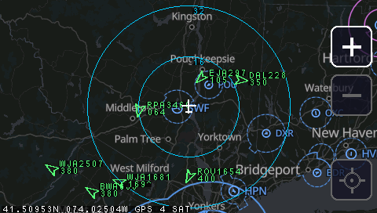
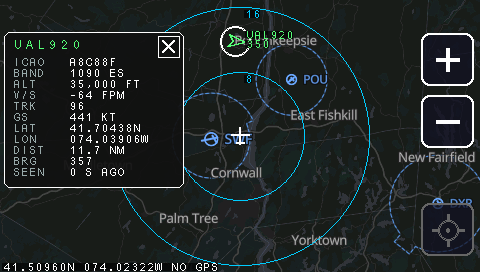
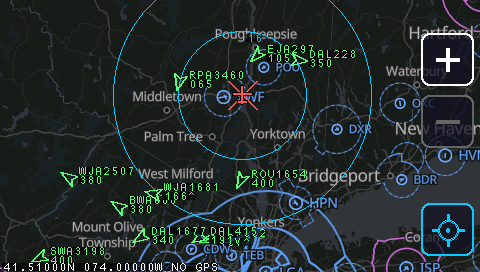

# ADS-B Radar & Moving Map

A portable aircraft traffic display for the **STM32F746G-DISCO** board, written in
bare-metal Ada. Nearby aircraft received by an ADSBee dual-band ADS-B receiver are
drawn over a moving map on the board's 4.3-inch touchscreen, centred on the user's
GPS position.

Final project for ENPM615, University of Maryland.

> **Advisory only. Not for navigation.** This is a student project. It is not
> certified, and the map data is not an aeronautical chart.



*Screenshot from the board: own ship (white cross) with a 4-satellite GPS fix,
range rings, and ADS-B traffic with callsigns and altitudes (hundreds of feet).*

---

## Features

- **Moving map** from pre-rendered tiles on a microSD card. The map follows the
  own-ship position, and range steps are 2, 4, 8, 16 and 32 NM.
- **Live ADS-B traffic** on 1090 MHz (Mode S ES) and 978 MHz (UAT) from the ADSBee
  m1421:
  - each aircraft is drawn as a chevron pointing along its track, or a diamond
    when the track is unknown;
  - labels show callsign or ICAO address, altitude, and a climb/descent arrow;
  - an aircraft's symbol is hidden after 20 s without a position, and the aircraft
    is dropped after 60 s without any report.
- **Own ship from GPS** (GT-U7, NMEA):
  - the status line shows `GPS n SAT`, `NO GPS` or `GPS LOST`;
  - the own-ship symbol turns red with an X when there is no live fix.
- **Touch controls:**
  - **+** and **−** zoom in and out;
  - dragging the map pans it, and the centre button re-centres on own ship;
  - tapping an aircraft opens its details panel. The panel's **CENTER & FOLLOW**
    button keeps the map centred on that aircraft.
- **Screenshots on the board:** press the blue USER button to save the screen to
  the SD card as `SHOTnnnn.BMP`.
- **Robust serial input:**
  - both UARTs are read by interrupt into ring buffers;
  - the parsers check checksums and never raise, so malformed data cannot stop the
    system;
  - no heap allocation after start-up.

| Aircraft details panel | Without a GPS fix |
| --- | --- |
|  |  |

The details panel shows:

- ICAO address and band;
- altitude, vertical speed, track and ground speed;
- position;
- distance and bearing from own ship;
- time since the aircraft was last heard.

Without a fix, the map uses a built-in start position, or the last known fix if the
fix was lost.

---

## Hardware

| Part | Notes |
| --- | --- |
| [STM32F746G-DISCO](https://www.st.com/en/evaluation-tools/32f746gdiscovery.html) | Cortex-M7 at 216 MHz, 8 MB SDRAM, 480×272 capacitive touch LCD, microSD slot |
| [ADSBee 1090/UAT m1421](https://github.com/CoolNamesAllTaken/adsbee) | Dual-band ADS-B receiver. It tracks aircraft itself and sends CSBee text reports over UART |
| GT-U7 GPS module | NEO-6M compatible, NMEA 0183 at 9600 baud, 1 Hz |
| microSD card | FAT32 with an MBR (exFAT is not supported), holding the map tiles (~326 MiB) |

### Wiring

| Signal | Board pin | Connects to |
| --- | --- | --- |
| UART7 TX | PF7 | ADSBee RX |
| UART7 RX | PF6 | ADSBee TX |
| ADSBee VIN | 3V3 | ADSBee devkit 6-pin header |
| USART6 TX | PC6 (Arduino D1) | GPS RXD |
| USART6 RX | PC7 (Arduino D0) | GPS TXD |
| GPS VCC | 5V | GPS module (its I/O is 3.3 V) |
| USART1 (ST-LINK virtual COM port) | — | Debug log at 115200 baud |

---

## Building and flashing

Requirements:

- [Alire](https://alire.ad) (it fetches the GNAT ARM toolchain 12.2.1 and the
  dependencies below);
- [OpenOCD](https://openocd.org/), for flashing over the on-board ST-LINK.

```sh
alr build
openocd -f board/stm32f746g-disco.cfg -c "program bin/adsb_radar verify reset exit"
```

In VS Code, the **Build** and **Flash** tasks in `.vscode/tasks.json` run the same
commands.

The project uses the `embedded-stm32f746disco` runtime. Our code is built at
`-O2 -g`, and the SD card read loop needs `-O2`, so don't build at `-O0`.

Dependencies, pinned in `alire.toml`:

- [`stm32f746disco`](https://github.com/GNAT-Academic-Program/stm32f746disco),
  [`stm32_hal`](https://github.com/GNAT-Academic-Program/stm32_hal) and
  [`stm32_gui`](https://github.com/GNAT-Academic-Program/stm32_gui), from the GNAT
  Academic Program, derived from AdaCore's Ada Drivers Library;
- [`adl_middleware`](https://github.com/Fabien-Chouteau/adl-middleware), for the FAT
  file system and bitmap fonts.

---

## Preparing the SD card

The map is a set of standard 256×256 Web Mercator (XYZ) tiles. They are packed into
one file per zoom level and drawn on the board pixel for pixel, never scaled.

| Zoom | Range (centre to top edge) | Tiles | File size |
| --- | --- | --- | --- |
| 8 | 32 NM | 12 | 1.5 MiB |
| 9 | 16 NM | 42 | 5.3 MiB |
| 10 | 8 NM | 132 | 16.5 MiB |
| 11 | 4 NM | 484 | 60.5 MiB |
| 12 | 2 NM | 1,936 | 242 MiB |

Coverage is a 100-mile radius around New York City.

To install the map, copy `Tiles/sdcard/Z08.BIN` … `Z12.BIN` to the root of a FAT32
card. The card is read once at boot.

### Rebuilding the tiles

The PC-side tools are in `Tiles/`:

- `render_pmtiles.py` renders a Protomaps vector extract to PNG tiles with MapLibre
  GL in headless Chromium. It can draw airspace and airports from FAA NASR data.
- `stm32_tiles.py` packs PNG tiles into the `.BIN` files. It writes `MAPINFO.TXT`
  and, with `--preview`, preview images.

```sh
pip install playwright pillow numpy pyshp
python -m playwright install chromium

# Map data: pick the newest build from https://maps.protomaps.com/builds
pmtiles extract https://build.protomaps.com/<YYYYMMDD>.pmtiles nyc.pmtiles \
    --bbox=-75.9,39.25,-72.1,42.15 --maxzoom=12

python Tiles/render_pmtiles.py --pmtiles nyc.pmtiles --flavor dark --out tiles_osm \
    --airspace class_airspace_shape_files.zip --airports <APT_CSV>.zip
python Tiles/stm32_tiles.py --source tiles_osm --out sdcard --preview
```

The airspace and airport files come from the FAA's
[NASR subscription](https://www.faa.gov/air_traffic/flight_info/aeronav/aero_data/NASR_Subscription/).
Run either script with `--help` to see all options (label sizes, airspace classes,
L8 palette format and others).

The `.BIN` format is a 2048-byte header followed by fixed-size tile records, each
starting on a 512-byte sector boundary. `src/map/map_tiles.ads` is the authoritative
description of the header.


## Source layout

```
src/
  adsb_radar.adb   main loop: 20 ms tick, touch handling, follow mode, USER button
  adsbee/          UART7 driver (interrupt RX, 16 KB ring), line splitter, CSBee parser
  gps/             USART6 driver (interrupt RX, 2 KB ring), NMEA RMC/GGA parser, fix tracking
  nav/             geographic maths, own ship, aircraft table (64 slots by ICAO)
  map/             .BIN tile format, map view with a 24-tile LRU cache in SDRAM
  sdcard/          SD card driver (polled reads and writes)
  ui/              LTDC layers, overlay drawing, buttons, details panel, touch, screenshots
  debug/           debug log on the ST-LINK virtual COM port
Tiles/             map tile pipeline (Python) and the generated SD card files
tools/screenshot.py  capture the LCD over the ST-LINK into a PNG (OpenOCD)
```

## Credits and data sources

- **Board support:** the GNAT Academic Program crates and AdaCore's
  [Ada Drivers Library](https://github.com/AdaCore/Ada_Drivers_Library), from which
  they are derived, plus Fabien Chouteau's `adl_middleware`.
- **ADSBee:** CSBee report format from the
  [ADSBee firmware](https://github.com/CoolNamesAllTaken/adsbee).
- **Map data:** © [OpenStreetMap](https://www.openstreetmap.org/copyright)
  contributors, available under the Open Database License (ODbL). Vector tiles and
  styles by [Protomaps](https://protomaps.com/). Rendered with
  [MapLibre GL JS](https://maplibre.org/).
- **Aeronautical data:** FAA NASR airspace and airport data (public domain).